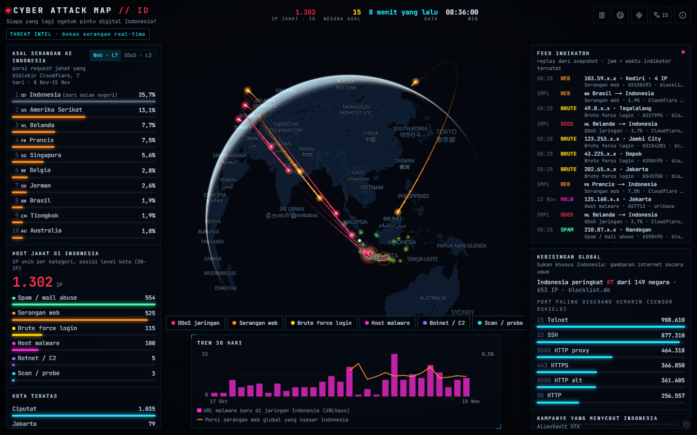
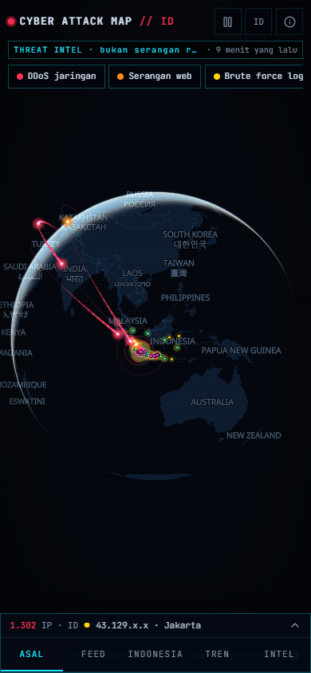

# Cyber Attack Map ID

[](https://github.com/Avalon2222/cyber-attack-map-id/actions/workflows/ci.yml)
[](https://github.com/Avalon2222/cyber-attack-map-id/actions/workflows/snapshot-ancaman.yml)
[](https://nextjs.org)
[](https://maplibre.org)
[](LICENSE)

> **Who's knocking on Indonesia's digital door?**
> Peta threat intel ala layar SOC: dari negara mana serangan ke Indonesia datang, host mana di jaringan Indonesia yang
> ketahuan jahat atau kebobolan, trennya 30 hari terakhir, dan kampanye yang lagi ngincer Indonesia. Semua dari feed publik.

**Live:** https://cyber-attack-map-id.vercel.app



<p align="center">
  
</p>

## 🇬🇧 In English

**A "hacker movie" style threat map for Indonesia, but honest about what it shows.** Animated arcs fly into Indonesia on
a dark WebGL globe, glowing dots pulse over Indonesian cities, and a terminal-style feed scrolls on the side. Every
pixel is backed by public threat intelligence, refreshed automatically every couple of hours:

- **Arcs** are random samples weighted by each origin country's share of attacks targeting Indonesia in
  [Cloudflare Radar](https://radar.cloudflare.com/security/id) (web/L7 and network DDoS/L3, last 7 days). They are a
  visualisation of proportions, not individual packets.
- **Dots** are Indonesian IPs reported as malicious or compromised: malware hosting (URLhaus), brute force, spam and
  web attacks (blocklist.de), botnet C2 (Feodo Tracker), and high-confidence abuse reports (AbuseIPDB). IPs are masked
  to `/16`, grouped per `/24`, and placed at city level using DB-IP.
- **Panels** show top origin countries, attack categories, top cities and networks, a 30-day trend, global noise
  (most attacked ports from DShield sensors, Indonesia's rank among attacking countries), campaigns targeting
  Indonesia from AlienVault OTX, ransomware claims by sector (victim names deliberately hidden), and official BSSN figures.

Built with Next.js 16, TypeScript, Tailwind 4 and MapLibre GL (globe projection, custom 2D canvas for arcs).
Data pipeline in TypeScript on GitHub Actions. Deployed on Vercel. Bilingual (ID/EN), keyboard-driven, tested on
phones (360, 390, 412 px) and desktop (1440 px). *The rest of this README is in Indonesian.*

## Kenapa

Peta serangan siber yang keren biasanya punya satu masalah: busurnya acak, angkanya gak jelas dari mana, dan semua
orang ngira itu serangan live. Proyek ini mau bikin vibe yang sama (globe gelap, busur nyala, feed jalan terus),
tapi tiap busur dan titik bisa ditelusuri ke sumber publiknya, dan batasannya ditulis terang-terangan di dalam app.

## Cara baca peta

| Elemen | Artinya | Sumber |
|---|---|---|
| Busur oranye | Sampel serangan web (L7) ke Indonesia, peluangnya sebanding porsi negara asal | Cloudflare Radar |
| Busur merah | Sampel DDoS jaringan (L3) ke Indonesia. Lokasi = data center Cloudflare yang menerima trafik, karena IP sumber DDoS sering dipalsukan | Cloudflare Radar |
| Bidikan merah di Jakarta | Titik akhir busur. Datanya cuma level negara, jadi semua busur mendarat di sekitar Jakarta | – |
| Titik magenta | Host yang nyebarin malware (biasanya router/IoT yang kena Mozi/Mirai) | URLhaus feed Indonesia |
| Titik kuning / hijau / oranye | IP Indonesia yang ketahuan brute force, spam, atau nyerang web dalam 48 jam terakhir | blocklist.de |
| Titik ungu | Server botnet C2 di Indonesia | Feodo Tracker |
| Titik putih | IP Indonesia di blacklist AbuseIPDB (confidence ≥ 90%) | AbuseIPDB |
| Riak di titik | "Ping" acak dari daftar host, jam di feed = waktu indikator itu tercatat | – |

**Penting:** ini threat intelligence, bukan rekaman serangan real-time. Negara asal = lokasi IP pengirim, belum tentu
lokasi pelakunya (VPN, proxy, botnet). Titik di Indonesia kebanyakan korban yang perangkatnya dibajak, bukan pelaku.

## Sumber data

| Sumber | Dipakai untuk | Kunci | Lisensi / ketentuan |
|---|---|---|---|
| [Cloudflare Radar](https://radar.cloudflare.com/security/id) | Asal serangan L7/L3 ke Indonesia, tren porsi harian | token gratis | CC BY-NC 4.0 |
| [abuse.ch URLhaus](https://urlhaus.abuse.ch/feeds/) (feed negara ID) | Host malware di jaringan Indonesia, tren 30 hari | – | CC0 |
| [abuse.ch Feodo Tracker](https://feodotracker.abuse.ch/) | Botnet C2 di Indonesia | – | CC0 |
| [blocklist.de](https://www.blocklist.de/en/export.html) | IP penyerang 48 jam (SSH, mail, web, dst.), sebaran negara | – | bebas dipakai |
| [SANS ISC DShield](https://isc.sans.edu/) | Port paling diserang di sensor global | – | CC BY-NC-SA |
| [AbuseIPDB](https://www.abuseipdb.com/) | Blacklist IP (confidence ≥ 90%), sebaran negara | key gratis | ditampilkan teragregasi |
| [AlienVault OTX](https://otx.alienvault.com/) | Kampanye (pulse) yang mencantumkan Indonesia sebagai target | key gratis | – |
| [ransomware.live](https://www.ransomware.live/) | Klaim korban ransomware di Indonesia per sektor (tanpa nama korban) | – | – |
| [DB-IP Lite](https://db-ip.com/db/lite.php) | Geolokasi IP level kota + ASN | – | CC BY 4.0 |
| BSSN (lewat pemberitaan) | Angka resmi anomali trafik per tahun | – | ditulis tangan + tautan sumber |

Basemap © [OpenFreeMap](https://openfreemap.org) dan © OpenStreetMap contributors.

## Cara kerja

```
URLhaus · blocklist.de · Feodo · DShield ─┐
Cloudflare Radar · AbuseIPDB · OTX ───────┼─ scripts/ambil_data.ts ─▶ cabang `data`/ancaman.json   (GitHub Actions, tiap ~2 jam)
ransomware.live · DB-IP Lite ─────────────┘                          public/data/ancaman.json       (snapshot bawaan di repo)

browser ─▶ ambil dua-duanya, pakai yang paling baru ─▶ MapLibre globe + kanvas busur + panel
```

- **Pipeline.** `src/lib/pipa/parser.ts` berisi parser murni per feed, `geoip.ts` indeks DB-IP (binary search,
  koordinat cuma disimpan untuk Indonesia biar hemat memori), `ringkas.ts` menggabungkan semuanya. Kalau satu sumber
  down atau kuotanya habis (AbuseIPDB gratis cuma 5x sehari), bagian dari snapshot lama dipakai lagi, jadi peta gak
  tiba-tiba kosong.
- **Privasi.** IP lengkap gak pernah masuk JSON: disamarkan jadi `103.172.x.x`, id titik pakai hash. Ada tes yang
  gagal kalau ada IPv4 lengkap nyelip di snapshot. Nama korban ransomware sengaja dibuang di parser.
- **Busur.** `src/lib/serangan.ts` milih negara asal secara acak berbobot porsi Radar, bikin lintasan lingkaran besar,
  lalu `src/lib/kanvas/animasi.ts` menggambarnya di kanvas 2D di atas globe pakai matriks proyeksi MapLibre (lengkap
  dengan uji oklusi di balik bumi). Kepala busur menyala dengan ekor, riak saat mendarat.
- **Keamanan.** Content-Security-Policy ketat (`src/lib/keamanan.ts`), gak ada API key di browser: semua kunci cuma
  ada di GitHub Actions secrets.

## Jalankan lokal

```bash
npm install
npm run dev
```

Buka http://localhost:3000. Snapshot bawaan di `public/data/ancaman.json` langsung kepakai.

Bangun ulang snapshot sendiri (kunci opsional; tanpa kunci, sumbernya dilewati):

```bash
CLOUDFLARE_API_TOKEN=... OTX_API_KEY=... ABUSEIPDB_API_KEY=... npm run data
```

| Kunci | Cara dapat |
|---|---|
| `CLOUDFLARE_API_TOKEN` | dash.cloudflare.com → My Profile → API Tokens → Create Token → Custom, izin **Account · Radar · Read** |
| `OTX_API_KEY` | daftar di otx.alienvault.com → Settings / API Integration → OTX Key |
| `ABUSEIPDB_API_KEY` | daftar di abuseipdb.com → Account → API → Create Key |

Di GitHub, simpan ketiganya sebagai **Actions secrets** dengan nama yang sama.

## Tes

```bash
npm test            # unit test (parser, GeoIP, penggabungan, penjadwal busur, i18n, privasi snapshot)
npm run build
npm run test:e2e    # Playwright: 360, 390, 412, 1440 px
```

CI menjalankan typecheck, lint, unit test, build, dan Playwright di tiap push.

## Pintasan

| Tombol | Fungsi |
|---|---|
| `Spasi` | Jeda / lanjutkan animasi |
| `G` | Globe ↔ peta datar |
| `R` | Kembali ke Indonesia |
| `L` | Bahasa Indonesia ↔ English |
| `I` atau `?` | Tentang data + status tiap sumber |
| `Esc` | Tutup panel |

## Lisensi

Kode: [MIT](LICENSE). Data tetap mengikuti lisensi sumber masing-masing (lihat tabel di atas).
